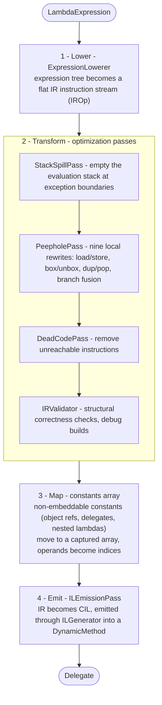

# Compiler Overview

`HyperbeeCompiler` compiles `LambdaExpression` trees to `DynamicMethod` delegates through a
four-stage pipeline: **Lower -> Transform -> Map -> Emit**.

---

## Compilation Pipeline



---

## IR Instruction Set

The intermediate representation (`IROp`) maps closely to CIL but at a slightly higher abstraction.
Key categories:

| Category | Examples |
|----------|---------|
| Constants & locals | `LoadConst`, `LoadLocal`, `StoreLocal`, `LoadArg` |
| Fields | `LoadField`, `StoreField`, `LoadStaticField`, `LoadFieldAddress` |
| Arrays | `LoadElement`, `StoreElement`, `NewArray`, `LoadArrayLength` |
| Arithmetic | `Add`, `Sub`, `Mul`, `Div`, `Negate`, `AddChecked`, ... |
| Comparison | `Ceq`, `Clt`, `Cgt`, `CltUn`, `CgtUn` |
| Conversion | `Convert`, `ConvertChecked`, `Box`, `UnboxAny`, `CastClass`, `IsInst` |
| Calls | `Call`, `CallVirt`, `NewObj`, `Constrained` |
| Control flow | `Branch`, `BranchTrue`, `BranchFalse`, `Label`, `Leave` |
| Exceptions | `BeginTry`, `BeginCatch`, `BeginFinally`, `BeginFault`, `Throw`, `Rethrow` |
| Stack | `Dup`, `Pop`, `Ret` |

---

## AsyncBlockExpression Integration

When `HyperbeeCompiler.Compile()` processes a lambda containing `AsyncBlockExpression`, it sets
itself as the ambient `ICoroutineDelegateBuilder` via `CoroutineBuilderContext`. When the
`AsyncBlockExpression` reduces (generating its `MoveNext` lambda), the ambient builder is picked
up automatically, and HEC compiles the `MoveNext` body rather than the System compiler.

This is transparent to callers -- no special options are needed:

```csharp
// HEC compiles both the outer lambda AND the inner MoveNext state machine
var fn = HyperbeeCompiler.Compile( outerLambdaContainingBlockAsync );
```

### Captured variables

A coroutine block that reads a variable owned by an enclosing scope is a closure boundary.
Its `MoveNext` body cannot be compiled in isolation -- on its own it would lose the
variable -- so it is emitted inline and shared with the enclosing compilation, which binds
the variable through a `StrongBox`. Blocks that capture nothing keep the standalone
pre-compiled body.

The consequence is a trade: a capturing coroutine gives up the execution advantage of a
standalone body, landing at roughly System-compiler speed, in exchange for correct
variable sharing. When the block reads and writes only its own variables, nothing changes.
See [Coroutine bodies](performance.md#coroutine-bodies) for the measured difference.

For `AsyncBlockExpression` reductions that occur outside an explicit `HyperbeeCompiler.Compile()`
call (e.g., in outer expressions compiled by the System compiler), call `UseAsDefault()` at
application startup:

```csharp
// Register HEC as the default builder for all AsyncBlockExpression reductions
HyperbeeCompiler.UseAsDefault();
```

---

## Invoked Lambdas

`Expression.Invoke( lambda, args )` is inlined at the call site during lowering: the body runs in
the calling frame with its parameters bound as block variables. No delegate is compiled for the
lambda, and an enclosing variable it reads stays an ordinary local rather than becoming a capture.

---

## Expression Support

HEC supports all standard `ExpressionType` values, plus all `Hyperbee.Expressions` custom types.
Patterns not supported by FastExpressionCompiler that HEC handles include:

- `RuntimeVariables` expressions (`IRuntimeVariables`)
- `Dynamic` expressions
- Certain complex `TryCatch` patterns with result values
- Nested lambda closures over struct fields

---

## Notes

- Compilation is thread-safe -- `HyperbeeCompiler` has no instance state.
- The IR is not cached -- each `Compile()` call traverses and emits from scratch.
- For heavy compilation workloads, consider compiling once and caching the delegate.
- See [API Reference](api.md) for all public methods.
- See [Performance](performance.md) for benchmark results.
